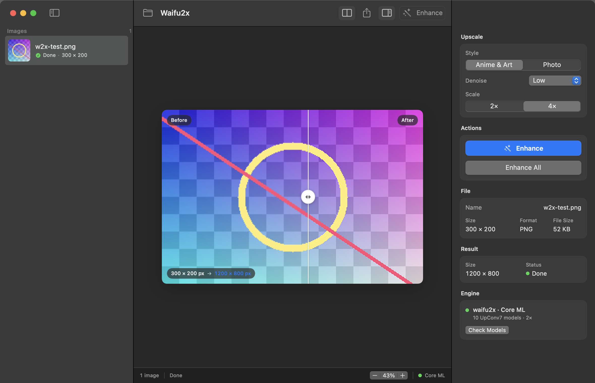

<p align="center">
  
</p>

<h1 align="center">Waifu2x</h1>

<p align="center">
  Native macOS image upscaler powered by waifu2x and Core ML.<br>
  Everything runs on your Mac — no uploads, no Python, no browser.
</p>

<p align="center">
  <code>macOS 14+</code> · <code>SwiftUI</code> · <code>Core ML</code> · <code>English / Русский</code>
</p>



## Features

- **Real waifu2x models.** Ten bundled UpConv7 Core ML models for anime and photo, with five denoise levels.
- **2× and 4× upscaling.** 4× runs a second 2× pass with the plain model to avoid over-smoothing.
- **Transparent images stay transparent.** Alpha is scaled separately and recombined after inference.
- **Built for batches.** Drag in a folder of images, enhance the queue, and export everything at once.
- **Before / after comparison.** A draggable split view makes the result easy to judge.
- **Native by design.** SwiftUI, Quick Look thumbnails, drag and drop, keyboard shortcuts, light and dark mode.
- **Private by default.** Images never leave the machine. No analytics, accounts, or network calls.
- **Follows your language.** English and Russian are included; the app matches the macOS system language.

## Requirements

- macOS 14 Sonoma or later
- Apple silicon recommended (Core ML uses the Neural Engine / GPU when available)
- Xcode Command Line Tools to build from source

## Install

Download `Waifu2x.app.zip` from the [latest release](../../releases/latest), unzip it, and move `Waifu2x.app` to `/Applications`.

The build is ad-hoc signed, not notarized. On first launch, use **Open Anyway** in System Settings → Privacy & Security if macOS asks.

### Build from source

```sh
git clone https://github.com/eqhow/waifu2x-macos.git
cd waifu2x-macos
./Scripts/build-app.sh release
open dist/Waifu2x.app
```

To install the locally built app:

```sh
ditto dist/Waifu2x.app /Applications/Waifu2x.app
open /Applications/Waifu2x.app
```

## Command line

The same engine is available without the UI:

```sh
swift build -c release

.build/release/Waifu2x --upscale input.png --output output.png --scale 2
.build/release/Waifu2x --upscale input.png --output output.png --scale 4 --style photo
.build/release/Waifu2x --models
```

Run `.build/release/Waifu2x --help` for all options. Output format is chosen from the extension: `.png` or `.jpg` / `.jpeg`.

## How it works

The app ships the original 10-model waifu2x UpConv7 set converted to Core ML. Each model takes a `3×156×156` tile and produces a `3×284×284` result: a 142 px core plus 7 px of context on each side. Tiles overlap by the context border, so the seams disappear without blending heuristics. If the models are missing or Core ML is unavailable, the app falls back to a high-quality Lanczos path instead of failing.

## Credits

- [waifu2x](https://github.com/nagadomi/waifu2x) by nagadomi — original model and algorithm (MIT)
- [waifu2x-caffe](https://github.com/lltcggie/waifu2x-caffe) by lltcggie — Caffe implementation (MIT)
- [waifu2x-ios](https://github.com/imxieyi/waifu2x-ios) by imxieyi — Core ML model conversion (MIT)

Upstream models and code are MIT-licensed. See [THIRD_PARTY_NOTICES.md](THIRD_PARTY_NOTICES.md) and the in-app **Credits** tab for details.
